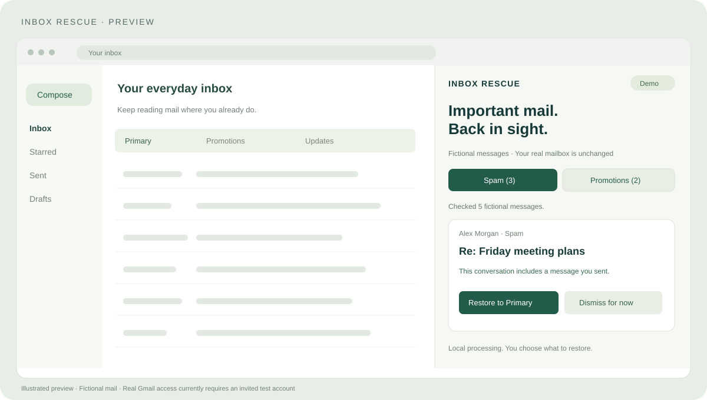

# Inbox Rescue

**Give important mail a second look — right beside Gmail.**

An open-source browser side panel that helps you review messages in Spam and Promotions, explains recent correspondence, and lets you choose what belongs in Primary.

[Download Preview](https://github.com/Zack-cpu/inbox-rescue/releases) · [Install in one minute](docs/INSTALL.md) · [Report a problem](https://github.com/Zack-cpu/inbox-rescue/issues/new/choose)

> **Preview access:** Anyone can try the fictional-mail demo. Real Gmail connections currently require an invitation to the project's Google test-user list. Public Gmail access is not available yet. No Google Cloud setup is required for users of the configured release package.



*Illustrated preview using fictional mail. The panel is opened from your browser toolbar beside Gmail.*

## Get started

1. Download `inbox-rescue-extension-v0.3.0-preview.zip` from [Releases](https://github.com/Zack-cpu/inbox-rescue/releases). Use the extension asset, not GitHub's automatic Source code ZIP.
2. Extract it. In `edge://extensions` or `chrome://extensions`, enable **Developer mode**, choose **Load unpacked**, and select the extracted folder containing `manifest.json`.
3. Open Gmail, pin **Inbox Rescue** to the toolbar, and click its icon to open the side panel.
4. Click **Try a demo instead**, or, if your account is invited, **Connect Gmail**. The first real scan starts after authorization.

No Python, terminal, server, credentials JSON, or client ID is needed. Manual loading is required for this GitHub preview; there is no store installation or automatic update yet. Downloads appear once a Preview release has been published.

See the [Chrome / Edge installation guide](docs/INSTALL.md) for troubleshooting and updates.

## What it does

- **Separate Spam and Promotions queues.** Review each category without mixing messages together.
- **Explainable correspondence checks.** Find messages from addresses you contacted or conversations you participated in.
- **Manual control.** Inspect a message in Gmail, confirm a restore to Primary, and undo the label change while the results remain open.
- **Local processing.** The extension talks directly to Google. No app server, third-party AI service, or analytics pipeline receives your mail.
- **Optional demo.** Explore the review flow before granting mailbox access.

## What to expect

Scans cover up to 100 Spam/Promotions messages from the last 7 days, using up to 300 sent messages from 90 days as correspondence history. Progress and limits are shown.

This is a correspondence-based review tool. It can miss important messages from new senders, and prior contact does not prove a sender is safe. It does not analyze every message for importance or guarantee future Gmail classification. No automatic restores or sending are implemented.

## Privacy and account access

Google asks for `gmail.modify` to read message metadata and apply user-confirmed label changes. That scope is broad and technically permits sending, although Inbox Rescue has no send operation.

Access tokens are kept in browser-session storage and expire; reconnect when prompted. Fetched message metadata and undo actions live in panel memory and disappear when results are cleared, rescanned, or the panel reloads. Disconnecting does not reverse earlier mail changes.

[Read the privacy summary](docs/PRIVACY.md) · [Security details](SECURITY.md)

Inbox Rescue is an independent project and is not affiliated with Google or Microsoft.

## Preview feedback

The most useful feedback is whether this helped you find a message you would otherwise have missed, and which parts of installation or review were confusing. Use [Issues](https://github.com/Zack-cpu/inbox-rescue/issues/new/choose); redact personal addresses, message content, tokens, and credentials before sharing screenshots.

If you find it useful, a GitHub star helps others discover the project.

## Development

The browser extension is the primary interface. With Node.js 22+:

```sh
node --test extension/tests/*.test.mjs
node scripts/build-extension.mjs
```

Load the resulting configured folder for release testing. Loading the source `extension/` folder directly is a maintainer workflow and may produce a different redirect URL. See [maintainer instructions](extension/MAINTAINERS.md).

The earlier Python/FastAPI prototype remains available for contributors in [the prototype guide](docs/PYTHON_PROTOTYPE.md). It is not required to use the browser extension.

## Roadmap

- [x] Gmail side panel, category queues, explicit restore and undo
- [x] Preconfigured test package and one-click connection entry point
- [ ] Fixed-ID package validation with invited testers
- [ ] Google verification for public Gmail access
- [ ] Persistent review and undo history
- [ ] Store distribution and easier updates

[Contributing](CONTRIBUTING.md) · [Changelog](CHANGELOG.md) · [MIT License](LICENSE)
